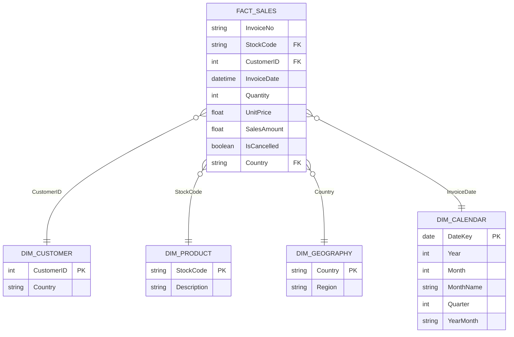

# Power BI Portfolio Project: Online Retail End-to-End Analytics

This guide provides step-by-step instructions to build a recruiter-wowing, interactive Power BI dashboard using your **Online Retail** dataset. It walks you through setting up the relational data model (Star Schema), writing advanced DAX measures, and designing a clean, professional visual layout.

---

## 1. Data Model Architecture (Star Schema)

To showcase database design proficiency (crucial for any data analyst role), we transformed the single flat "Online Retail" spreadsheet into a relational **Star Schema**. 

Here is the database model you will build in Power BI:



### Table Reference:
*   **FactSales (`fact_sales.csv`)**: Contains transactional facts. Note that rows with negative quantities or invoice numbers starting with "C" represent returns or cancellations. Missing CustomerIDs have been mapped to `-1` ("Guest Checkout") to avoid losing 25% of sales volume!
*   **DimCustomer (`dim_customers.csv`)**: Unique customer list.
*   **DimProduct (`dim_products.csv`)**: Normalized catalog mapping unique `StockCode`s to their dominant text description.
*   **DimGeography (`dim_geography.csv`)**: Unique countries mapped to broader global regions (Europe, Asia, Americas, Oceania) to enable geographic hierarchy visuals.
*   **DimCalendar (DAX Table)**: A dedicated date dimensions table to power Time Intelligence functions.

---

## 2. Ingesting & Formatting Data in Power BI

### Step 1: Import CSVs
1. Open **Power BI Desktop**.
2. Click **Get Data** -> **Text/CSV**.
3. Import the 4 CSV files located in your project directory: `/Users/meow/.gemini/antigravity/scratch/powerbi_portfolio/clean_data/`
   * `fact_sales.csv`
   * `dim_customers.csv`
   * `dim_products.csv`
   * `dim_geography.csv`

### Step 2: Transform Data in Power Query
Once the files are loaded, click **Transform Data** to open Power Query Editor. Make the following minor adjustments to optimize typing:
1.  **FactSales**:
    *   Change `InvoiceDate` data type to **Date/Time**.
    *   Ensure `CustomerID` is set to **Whole Number** (change from Decimal if needed).
    *   Ensure `Quantity` is set to **Whole Number** and `UnitPrice` to **Fixed Decimal Number** (Currency).
    *   Ensure `SalesAmount` is set to **Fixed Decimal Number** (Currency).
2.  **DimCustomer**:
    *   Ensure `CustomerID` is set to **Whole Number** (Crucial: the data types of key columns must match exactly to build relationships).
3.  **DimProduct**:
    *   Ensure `StockCode` is set to **Text**.
4.  Click **Close & Apply** in the top-left corner.

### Step 3: Establish Relationships (Model View)
Go to the **Model View** (the third icon on the left sidebar in Power BI) and configure the relationships:
1.  Drag `dim_customers[CustomerID]` to `fact_sales[CustomerID]` (1-to-many, Single direction filter).
2.  Drag `dim_products[StockCode]` to `fact_sales[StockCode]` (1-to-many, Single direction filter).
3.  Drag `dim_geography[Country]` to `fact_sales[Country]` (1-to-many, Single direction filter).

---

## 3. Creating a Dynamic DAX Calendar Table

A separate, custom calendar table is a requirement for advanced DAX time intelligence. We will write a DAX expression to generate one dynamically.

1. Go to the **Report View** or **Table View**.
2. Under the **Modeling** tab, click **New Table**.
3. Paste the following DAX code:

```dax
DimCalendar = 
VAR MinDate = MIN(fact_sales[InvoiceDate])
VAR MaxDate = MAX(fact_sales[InvoiceDate])
RETURN
ADDCOLUMNS(
    CALENDAR(MinDate, MaxDate),
    "Year", YEAR([Date]),
    "MonthNumber", MONTH([Date]),
    "MonthName", FORMAT([Date], "MMMM"),
    "MonthShort", FORMAT([Date], "MMM"),
    "Quarter", "Q" & FORMAT([Date], "Q"),
    "YearMonthNo", YEAR([Date]) * 100 + MONTH([Date]),
    "YearMonth", FORMAT([Date], "YYYY-MM"),
    "DayOfWeek", FORMAT([Date], "dddd"),
    "DayOfWeekNo", WEEKDAY([Date], 2)
)
```

### Steps to configure DimCalendar:
1. Set the sort-by column: Select the `MonthShort` or `MonthName` column, go to **Column Tools** -> **Sort by Column**, and select **MonthNumber** (otherwise, Power BI will sort months alphabetically: Apr, Aug, Dec...).
2. Sort `YearMonth` by `YearMonthNo`.
3. Go back to the **Model View** and connect `DimCalendar[Date]` to `fact_sales[InvoiceDate]` (Date to Date/Time relationship). 

---

## 4. DAX Measures Library

Create a blank table named `_Measures` to store your calculations.
*   *How:* Click **Enter Data** in the Home tab, name the table `_Measures`, and click Load.
*   Right-click `_Measures` and select **New Measure** to add the formulas below:

### Core Sales Measures

#### 1. Total Revenue
```dax
Total Revenue = SUM(fact_sales[SalesAmount])
```

#### 2. Total Transactions (Orders)
```dax
Total Transactions = DISTINCTCOUNT(fact_sales[InvoiceNo])
```

#### 3. Sales Quantity
```dax
Sales Quantity = SUM(fact_sales[Quantity])
```

#### 4. Active Customers
```dax
Active Customers = DISTINCTCOUNT(fact_sales[CustomerID])
```

---

### Cancellation & Return Analysis
Because cancellations represent significant revenue leaks, analyzing them is highly valuable.

#### 5. Cancelled Revenue
```dax
Cancelled Revenue = 
CALCULATE(
    SUM(fact_sales[SalesAmount]),
    fact_sales[IsCancelled] = TRUE
)
```

#### 6. Net Revenue (Actual Sales after Returns)
```dax
Net Revenue = [Total Revenue] + [Cancelled Revenue]
```
*(Note: Cancelled revenue is already negative in the source database, so we add it to get the net total).*

#### 7. Return Rate %
```dax
Return Rate % = 
DIVIDE(
    ABS([Cancelled Revenue]),
    [Total Revenue],
    0
)
```

---

### Time Intelligence (Performance Comparisons)

#### 8. Prior Month Revenue
```dax
Prior Month Revenue = 
CALCULATE(
    [Total Revenue],
    DATEADD(DimCalendar[Date], -1, MONTH)
)
```

#### 9. Month-over-Month (MoM) Revenue Growth %
```dax
MoM Revenue Growth % = 
VAR CurrentRev = [Total Revenue]
VAR PriorRev = [Prior Month Revenue]
RETURN
DIVIDE(
    CurrentRev - PriorRev,
    PriorRev,
    0
)
```

#### 10. 30-Day Moving Average Sales
```dax
30-Day Moving Average Sales = 
AVERAGEX(
    DATESINPERIOD(DimCalendar[Date], LASTDATE(DimCalendar[Date]), -30, DAY),
    [Total Revenue]
)
```

---

### Dynamic Customer Cohort Churn Analytics
This is the ultimate portfolio measure. Since this is transaction data (no subscription contracts), we define a "Churned Customer" as someone who has purchased previously but has **not purchased in the last 90 days**.

#### 11. Customers in Last 90 Days
```dax
Customers Last 90 Days = 
CALCULATE(
    [Active Customers],
    DATESINPERIOD(
        DimCalendar[Date],
        LASTDATE(DimCalendar[Date]),
        -90,
        DAY
    ),
    fact_sales[CustomerID] <> -1 -- Exclude guest checkouts
)
```

#### 12. Churned Customers (Inactive > 90 Days)
```dax
Churned Customers = 
VAR CustomersPrior = 
    CALCULATE(
        [Active Customers],
        DATESINPERIOD(
            DimCalendar[Date],
            FIRSTDATE(DATEADD(DimCalendar[Date], -90, DAY)),
            -365, -- Look back 1 year before that
            DAY
        ),
        fact_sales[CustomerID] <> -1
    )
VAR ActiveNow = [Customers Last 90 Days]
RETURN
IF(
    ISBLANK(ActiveNow),
    0,
    MAX(0, CustomersPrior - ActiveNow)
)
```

#### 13. Customer Churn Rate %
```dax
Portfolio Churn Rate % = 
DIVIDE(
    [Churned Customers],
    [Active Customers],
    0
)
```

---

## 5. Visual Dashboard Design Blueprint

Aim for a high-end, premium aesthetic. Avoid default styles.

### Design Theme
*   **Background:** Off-Black / Charcoal (`#121214`) or sleek light mode (`#F8F9FA` background with `#FFFFFF` cards).
*   **Accent Color 1 (Primary Value):** Emerald/Teal (`#00F2FE` or `#00B4D8`) - Represents growth/revenue.
*   **Accent Color 2 (Negative Alerts):** Coral/Soft Red (`#FF6B6B`) - Represents returns and churn.
*   **Font:** Segoe UI or Outfit (clean sans-serif).

### Page 1: Executive Sales Overview
This page gives leadership a high-level view of retail performance.
*   **KPI Cards (Top):**
    *   Net Revenue (Large size, teal color) with MoM Growth % underneath in small text.
    *   Total Transactions.
    *   Return Rate % (colored coral if > 5%).
    *   Active Customers.
*   **Main Visuals:**
    *   *Line Chart:* Net Revenue vs. 30-Day Moving Average over time (`DimCalendar[YearMonth]`).
    *   *Clustered Column Chart:* Revenue vs. Cost by Product Category (To show profitability).
    *   *Map / Treemap:* Sales Amount by Country / Region (`DimGeography[Region]`).
*   **Slicers (Filter Pane):**
    *   Year / Month slider.
    *   Product Category dropdown.

### Page 2: Product & Logistics Deep Dive
This page uncovers product efficiency and cancellations.
*   **KPI Cards:**
    *   Cancelled Revenue.
    *   Total Return Orders.
*   **Main Visuals:**
    *   *Scatter Plot:* Unit Price (X-axis) vs. Quantity Sold (Y-axis) colored by Product Category.
    *   *Table (Top Products):* Product Description, Quantity Sold, Gross Revenue, Return Rate. (Apply conditional formatting gradient to the Return Rate column to highlight issues).
    *   *Decomposition Tree:* Break down Cancelled Revenue by Country -> Product Category -> StockCode. This is a very impressive interactive visual.

### Page 3: Customer Retention & Churn (Advanced)
Demonstrate customer behavior insights.
*   **KPI Cards:**
    *   Total Registered Customers (excluding guest `-1`).
    *   Churned Customers.
    *   Portfolio Churn Rate %.
*   **Main Visuals:**
    *   *Area Chart:* Churn Rate % trends over time.
    *   *Bar Chart:* Churn Rate by Customer Segment or Country.
    *   *Table:* CustomerID, Days since Last Purchase, Total Lifetime Spend, Status (Active vs. Churned).
